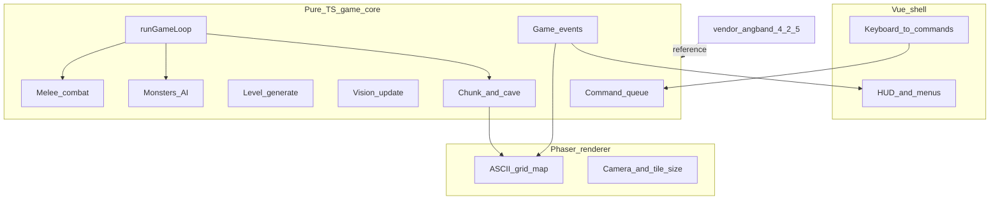

# Angband Remaster (Phaser + Vue + TypeScript)

Браузерный remaster [Angband](https://github.com/angband/angband): верный порт логики C→TypeScript, рендер ASCII в Phaser 3, Vue 3 для HUD/меню. Старт с dungeon loop, затем birth/town, потом тайлы.

Статус порта модулей: [parity.md](./parity.md).

## Decisions (locked)

- Upstream: официальный [angband/angband](https://github.com/angband/angband), git submodule на тег **4.2.5** (фиксируем версию; bump только осознанно).
- Стек: Vite + TypeScript + Phaser 3 (canvas/ASCII), Vue 3 Composition API для HUD/меню поверх canvas.
- Порт: логика верная (структуры, energy turn loop, command queue, events) — не inspired remake.
- Визуал: ASCII сначала, тайлы/спрайты позже, без смены game core.
- UI: Phaser только мир; Vue — сообщения, HP, глубина, потом birth/инвентарь/город.
- Лицензия: dual GPL-2.0 / Angband licence — сохранить copyright notices и совместимую лицензию в репо.

## Architecture

Разделение слоёв — главный принцип обучения и верного порта:



- `src/game/**` — чистый TS, без импортов Phaser/Vue. Vitest гоняет генерацию, FOV, бой без canvas.
- `src/render/phaser/**` — сцена, отрисовка chunk символами, камера.
- `src/ui/**` — Vue app, Pinia store, подписка на game-event аналог.
- `vendor/angband` — submodule; в каждом портированном файле комментарий `// port of src/foo.c`.

Паттерн порта: сохраняем имена сущностей Angband (`chunk`, `square`, `loc`, `energy`, `process_monsters`, `map_info`), но пишем идиоматичный TS (модули, типы; `player` передаём явно вместо глобалов).

## Repo layout

```
angband-remaster/
  vendor/angband/          # submodule @ 4.2.5
  src/
    game/
      z/                   # z-rand, z-type, z-queue
      cave/
      generate/
      cmd/
      player/
      mon/
      world/               # runGameLoop
      event/
    render/phaser/
    ui/                    # Vue
    main.ts
  public/
  index.html
  package.json
  parity.md                # C file -> TS module -> status
  README.md
```

## Setup

```bash
git clone --recurse-submodules <this-repo-url>
cd angband-remaster
npm install
```

Если клонировали без submodule:

```bash
git submodule update --init --recursive
```

Upstream зафиксирован на теге **4.2.5**. Не плавать на `master`, пока сознательно не обновите pin и [parity.md](./parity.md).

### Scripts

```bash
npm run dev        # Vite + Phaser + Vue
npm run test       # Vitest
npm run typecheck  # vue-tsc
npm run build      # production build
```

## Milestone 1 — Dungeon loop

Играбельный вертикальный срез без полного birth/town:

1. ~~Bootstrap: Vite + TS strict + Phaser + Vue + Vitest; submodule `vendor/angband@4.2.5`.~~ **done**
2. Z-слой: `z-rand`, `loc`, базовые типы — по `z-*.c` / `z-type`.
3. Cave: `chunk` / `square` / feat floor|wall|stairs — по `cave.h` / `cave.c` (урезанный набор feat).
4. Generate: classic-like (комнаты в блоках → коридоры → лестницы) по идеям `classic_gen` / `gen-room` / tunneling; паритет углублять итерациями.
5. Command queue + energy loop по [How It Works](https://angband.readthedocs.io/en/latest/hacking/how-it-works.html): monsters with energy → player → rest → `handle_stuff` → world tick.
6. Player: move / descend — зеркало `cmd-cave` / `cmd-core`.
7. Vision: `update_view` + remembered terrain + light radius + LOS.
8. Monsters: 1–2 вида; place; simplified noise/scent AI; урезанный melee.
9. Death + спуск на новый уровень.
10. Phaser ASCII map + Vue HUD (HP, depth, message log).

**Done when:** этаж генерится, ходьба/FOV работают, melee живой, спуск глубже, TS с ссылками на C.

### Progress checklist

| Step | Status |
|---|---|
| Vite + Vue 3 + TS strict + Phaser 3 + Vitest; LICENSE; scaffold | done |
| `vendor/angband` @ 4.2.5 + `parity.md` | done |
| Port z-rand / loc + chunk/square/feat; unit tests | pending |
| Classic-like level gen (rooms, corridors, stairs) | pending |
| Command queue + energy `runGameLoop` + move/descend | pending |
| Vision + monsters + simplified AI + melee | pending |
| Phaser ASCII renderer + Vue HUD; death / new level | pending |

## Milestone 2 — Character + town

- Birth (раса/класс/статы) + Vue wizard.
- Town level 0, магазины, базовый инвентарь.
- Парсер `lib/gamedata/*.txt` (colon-separated) в TS.

## Milestone 3 — Tiles and content

- Tileset вместо ASCII (тот же `map_info` → glyph/tile id).
- Больше профилей уровней, объекты, ловушки, спеллы — модуль за модулем.
- Savefile отдельным этапом.

## Дисциплина порта

- Читать C → типы → порт функции → тест поведения → UI.
- Phaser не импортировать в `src/game`.
- Вести [parity.md](./parity.md): stub / partial / parity.
- Сложные куски помечать partial со списком отличий от upstream.
- В каждом портированном файле: `// port of src/foo.c`.

## Risks

- Полный Angband огромен: держим M1 и `parity.md`.
- Глобалы C → в TS явный `GameState`.
- Клавиатура: Phaser в dungeon, Vue в модалках.

## Licence

Dual **GPL-2.0 / Angband licence** — see [LICENSE](./LICENSE). Compatible with upstream Angband.
